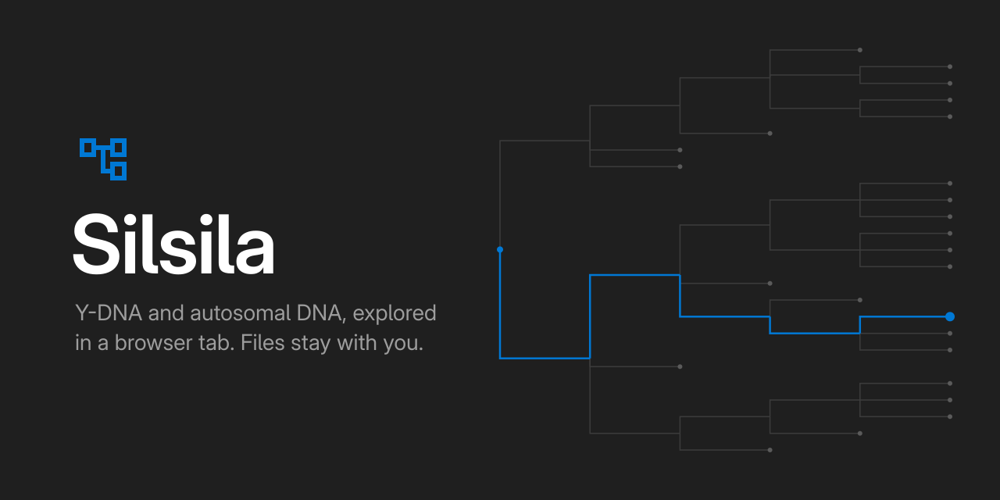
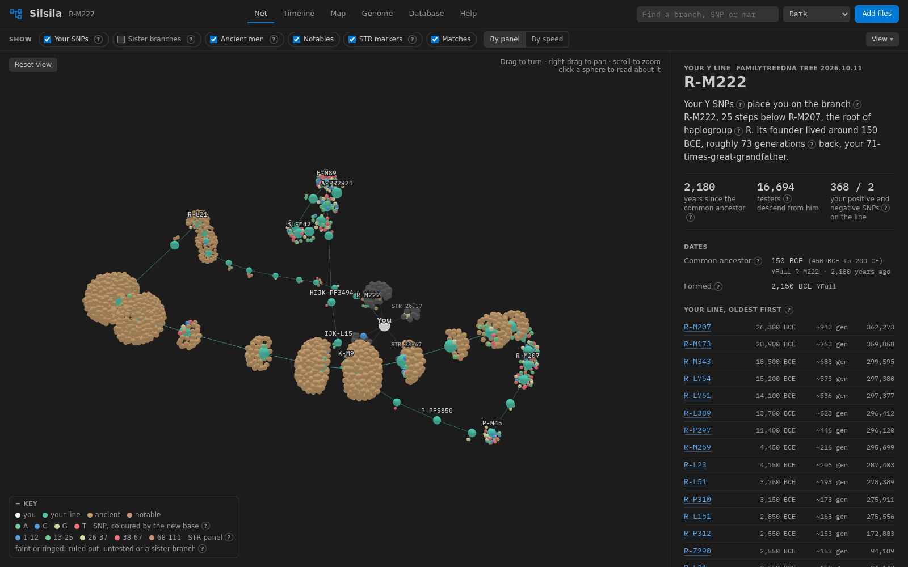
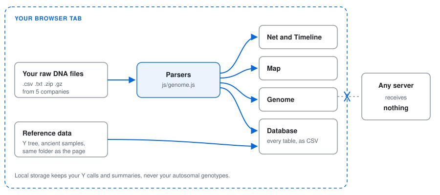
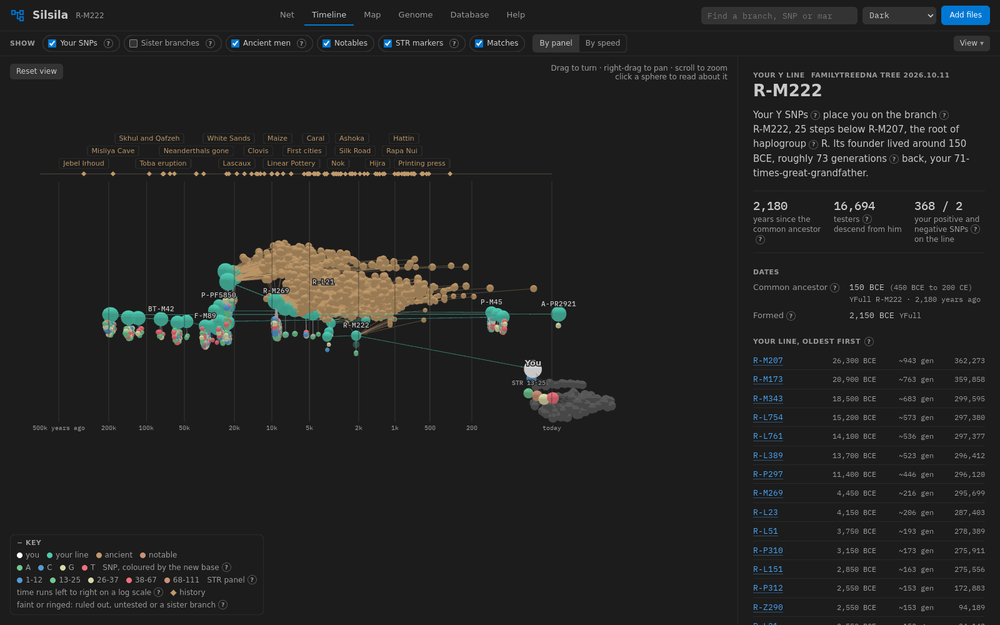
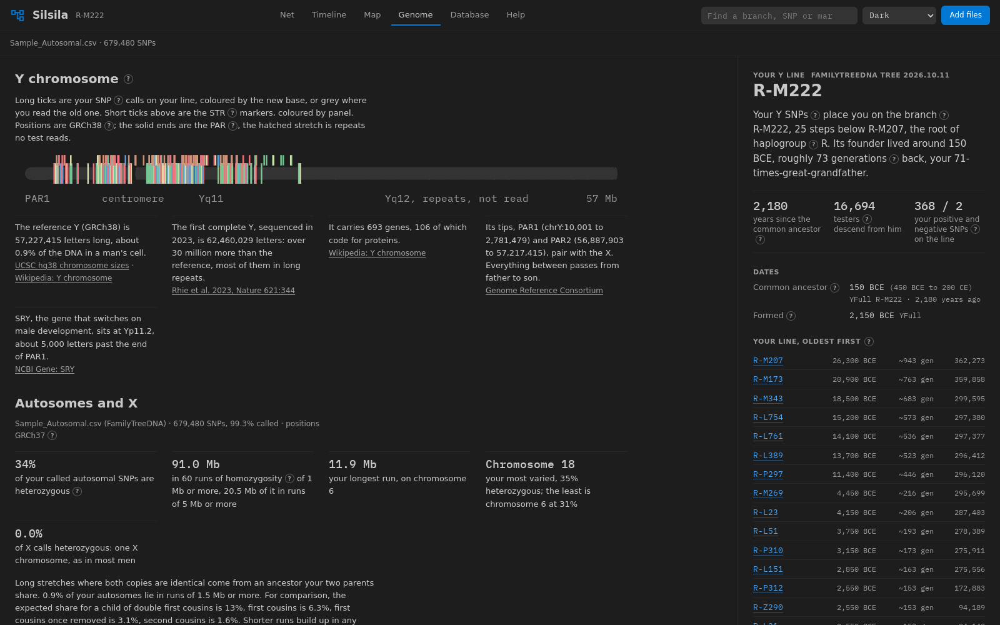

<p align="center"></p>

[](https://github.com/zakijss/Silsila/actions/workflows/ci.yml)
[](https://github.com/zakijss/Silsila/releases)
[](LICENSE)

# Silsila

Silsila reads the raw DNA files you download from FamilyTreeDNA, 23andMe, AncestryDNA, MyHeritage or Living DNA and shows you what is in them, in a browser tab, without sending them anywhere. A file with Y calls places a paternal line on the FamilyTreeDNA Y tree and links each branch on it to its age, the ancient men who share it, notable families, testers' countries, STR markers and your matches. An autosomal file, which everyone has, fills the Genome view: chromosomes, runs of homozygosity, trait SNPs and a one-to-one comparison with a relative's file.



## Privacy

Silsila is a static page with no server side. Files you add are read by JavaScript on your own machine and are never uploaded, and the page makes no requests to other sites: the libraries, fonts, images and reference data all come from the same folder as `index.html`. Links to FamilyTreeDNA, YFull, Wikipedia and the cited papers only open when you click them.

What it keeps, in your browser's local storage under keys starting with `silsila.`:

| Kept | Not kept |
|---|---|
| your Y calls, STR values and match lists (which include your matches' names) | the rest of your autosomal genotypes |
| summaries of the autosomal file (per-chromosome counts, runs of homozygosity) and its genotypes at the trait SNPs | a relative's file, or the comparison with it; both live in memory and go when you close the tab |
| view settings, the theme, whether you have seen the tour | |

Clear my data, under Add files, deletes the stored results. Anyone who hosts a copy of Silsila serves the page and nothing more; they never see the files you load into it.

## How it works



The browser reads each file you add, unpacks it if it is a `.zip` or `.gz`, and hands the text to `js/genome.js`, which works out the company, the build and the calls. The views in `js/app.js` draw from those calls and from the reference data in `data/`.

## Quick start

You need Python 3 and curl to build the reference data, and any modern browser to run it. Node.js is only for the tests.

```
git clone <this repository> silsila
cd silsila
mkdir -p cache
curl -L -o cache/haplotree.json https://www.familytreedna.com/public/y-dna-haplotree/get
curl -L -o cache/yfull.json https://raw.githubusercontent.com/YFullTeam/YTree/master/current_tree.json
curl -L -o cache/countries.geojson https://raw.githubusercontent.com/nvkelso/natural-earth-vector/v5.1.2/geojson/ne_110m_admin_0_countries.geojson
curl -L -o cache/v66.p1_1240K.aadr.PUB.anno https://dataverse.harvard.edu/api/access/datafile/13994515
python3 tools/build_data.py --ftdna cache/haplotree.json --yfull cache/yfull.json \
    --aadr cache/v66.p1_1240K.aadr.PUB.anno --chip data/chips/ftdna-family-finder-y.txt \
    --world cache/countries.geojson --aadr-version 'AADR v66' \
    --yfull-version "$(curl -s https://raw.githubusercontent.com/YFullTeam/YTree/master/current_version.txt)"
python3 -m http.server 8000
```

Then open http://localhost:8000, or open `index.html` straight from disk: every data file is a plain script, so the page also works from `file://`. The downloads come to about 160 MB and the build takes 10 to 20 seconds; it writes `data/tree.js` (about 5.5 MB), `data/ancient.js` (1.9 MB) and `data/world.js` (0.2 MB).

## Building the data

The repository ships the code, the hand-kept notes and a few small data files, but not the Y tree. The tree comes from FamilyTreeDNA, which publishes it without a licence to pass it on, so each copy of Silsila builds its own from the public download. `THIRD-PARTY.md` lists every source with its terms.

`tools/build_data.py` reads five downloads and writes three files:

| Option | File | Where to get it |
|---|---|---|
| `--ftdna` | the FamilyTreeDNA public haplotree, about 130 MB of JSON | https://www.familytreedna.com/public/y-dna-haplotree/get |
| `--yfull` | YFull's `current_tree.json`, for ages across the whole tree | https://github.com/YFullTeam/YTree |
| `--aadr` | an `.anno` file from the Allen Ancient DNA Resource, for ancient samples | Harvard Dataverse, doi:10.7910/DVN/FFIDCW. The Quick start URL fetches the v66 1240K file; for a later release, take the file id from the Dataverse page |
| `--chip` | the Y positions on the Family Finder chip | already in the repo: `data/chips/ftdna-family-finder-y.txt` |
| `--world` | Natural Earth 1:110m country shapes | the URL in Quick start |

`--ftdna-version` defaults to the date the haplotree was published. `--yfull-version` and `--aadr-version` are labels shown on the Help page.

Two more options let Y files in GRCh37 place as well as FamilyTreeDNA's GRCh38 Y file, which matters for 23andMe, AncestryDNA, MyHeritage and Living DNA:

```
curl -L -o cache/hg38ToHg19.over.chain.gz https://hgdownload.soe.ucsc.edu/goldenPath/hg38/liftOver/hg38ToHg19.over.chain.gz
python3 tools/build_data.py <the options above> --liftover cache/hg38ToHg19.over.chain.gz \
    --chip37 data/chips/23andme-y-grch37.txt --chip37 data/chips/ancestrydna-y-grch37.txt \
    --chip37 data/chips/myheritage-y-grch37.txt
```

UCSC lets independent researchers and nonprofits use the chain file for free; any other use needs a licence from UCSC.

`data/gmap.js`, the genetic map for comparing two people, is already in the repository. To rebuild it:

```
curl -L -o cache/plink.GRCh37.map.zip https://bochet.gcc.biostat.washington.edu/beagle/genetic_maps/plink.GRCh37.map.zip
python3 tools/build_gmap.py cache/plink.GRCh37.map.zip
```

### Ages, routes and countries for one line

FamilyTreeDNA's Discover site has better ages, ancient placements, notable lines and country counts for its own tree than the bulk download, but it sends no CORS headers, so the page cannot ask it directly. `tools/enrich.py` saves it for one branch and the line above it:

```
python3 tools/enrich.py R-M222
```

That writes `data/enrich/R-M222.js` and adds the branch to `data/enrich/index.js`. The page loads the file whenever that branch is on the line being shown. Without one, ages come from YFull and the map has no country counts or migration route.

The file is named after the branch you asked for. On a public copy, anyone can list `data/enrich/` and see which lines you looked up, so leave it out of a public deploy unless you mean to share that.

## Run with Podman or Docker

The `Containerfile` builds the reference data and serves the page with nginx, as a non-root user on port 8080. You need nothing else installed:

```
podman build -t silsila .
podman run --rm -p 8080:8080 silsila
```

or, with Docker:

```
docker compose up
```

Then open http://localhost:8080. The build downloads the same sources as Quick start and runs `tools/build_data.py` in a Python stage; the image keeps only the static files. It does not fetch UCSC's liftover chain, because of that file's licence terms, so Y files from 23andMe, AncestryDNA, MyHeritage and Living DNA will not place; build the data yourself (Building the data, above) if you need them. Your own `data/enrich/` lookups are left out of the image.

The container needs no write access except `/tmp`. To run it locked down without compose:

```
podman run --rm -p 8080:8080 --read-only --tmpfs /tmp --cap-drop ALL silsila
```

To keep it running as a service with rootless Podman, `deploy/silsila.container` is a Quadlet with the same locks. After `podman build -t silsila .`:

```
mkdir -p ~/.config/containers/systemd
cp deploy/silsila.container ~/.config/containers/systemd/
systemctl --user daemon-reload && systemctl --user start silsila.service
```

It serves on `127.0.0.1:8080`; edit `PublishPort=` to serve your network. `loginctl enable-linger` starts it at boot without a login.

## Hosting it

Silsila is static files; any web server will do. Copy these to the server and nothing else:

```
index.html  js/  lib/  assets/  data/
```

Leave out `tools/`, `test/`, `cache/` and any `personal/` folder. Read the last section of `THIRD-PARTY.md` before you put a built `data/tree.js` on the open internet.

Caddy:

```
silsila.example.org {
    root * /srv/silsila
    file_server
}
```

nginx:

```
server {
    listen 80;
    server_name silsila.example.org;
    root /srv/silsila;
    index index.html;
}
```

Any static host (GitHub Pages, Netlify, an S3 bucket) works the same way.

## Loading your files

Open the page, click Add files, and drop in what you downloaded. Files can go in as they came: `.gz`, `.zip`, `.csv` or `.txt`.

From FamilyTreeDNA, Silsila reads:

- the Family Finder raw data: the autosomal file, and for men the separate Y file;
- Y-STR results, as the CSV from the Y-STR Results page or the five tables copied and pasted into the box;
- Y-DNA matches and Family Finder matches, each as the CSV from Export CSV.

The Y file places you on the tree; STR results and matches hang off your line in the Net view; Family Finder matches with a Y haplogroup are placed where their line meets yours. To compare with a relative, load their autosomal file under Genome. It stays in memory and is not saved.

The raw files Silsila reads, by company:

| Company | Format | Y | Notes |
|---|---|---|---|
| FamilyTreeDNA Family Finder | CSV, `RSID,CHROMOSOME,POSITION,RESULT`, no header comment | separate Y file, GRCh38 | the autosomal file is GRCh37; newer kits mask the Y as chromosome 0 |
| 23andMe | tab-separated, `# rsid chromosome position genotype` | yes, one letter per call in men | build 37 (very old files say 36); i-numbers for some SNPs |
| AncestryDNA | tab-separated, allele1 and allele2 columns, chromosomes 23 to 26 for X, Y, PAR and MT, no-call `0 0` | yes | build 37.1 |
| MyHeritage | quoted CSV like FamilyTreeDNA's, with a `#` header | a few hundred Y SNPs | build 37 |
| Living DNA | tab-separated like 23andMe | none in the autosomal download | build 37 |

The company and build come from the header; FamilyTreeDNA states the build only in its file names. Y positions are matched against the tree in GRCh38 and GRCh37 and the better fit wins. A file with two X chromosomes has no real Y calls, only chip noise, so its Y calls are ignored.

Keep your own files outside the repository, or in `personal/`, which `.gitignore` excludes along with `.csv`, `.gz`, `.zip` and the usual raw-data file names.

## Views

Net shows your line from the first modern humans to your branch in 3D, with your SNPs, ancient samples, notable lines, the 111 STR markers and your matches hanging off it. Click a sphere and the reading panel explains it.

Timeline is the same network laid out by age on a log scale, with dated events in world history along the top.



Map is a globe with NASA's day or night Earth, the share of each country's testers on a chosen branch, ancient men whose line meets yours within the last 20,000 years, and FamilyTreeDNA's migration route for the line. A time bar scrubs from the deepest ancestor to today.

Genome draws the Y chromosome with SNP and STR positions, and with an autosomal file, all 22 autosomes and the X, heterozygosity per megabase, runs of homozygosity, trait SNPs and the comparison with a relative.



Database has every table behind the views (your line, all 110,000 branches, the indexed Y SNPs with your calls, STR markers, ancient samples, matches and more), filterable, sortable and exportable as CSV.

Help covers how to read each view, a glossary, the data sources, why there are no health reports, and a short tour that also runs on a first visit.

The 3D views use 3d-force-graph and globe.gl from `lib/`, loaded only when a 3D view first opens. Without WebGL, or with 2D picked in the View menu, D3 draws flat versions that also work from the keyboard. With reduced motion set in the system, nothing turns or flows on its own.

## Tests

```
node test/genome.test.js
for f in js/*.js data/*.js; do node --check "$f"; done
```

CI runs both. The first prints `all genome checks pass` or stops at the first failed assertion. It covers each company's format (from the header lines in `test/fixtures/`, real headers from public Personal Genome Project files over invented rows), zip and multi-member gzip, STR parsing, match lists, segment comparison and centimorgans, traits, runs of homozygosity, dates and distances. The placement checks on the real tree run only after `data/tree.js` is built, and the GRCh37 ones only if it was built with `--liftover`.

## How placement works

`js/genome.js` indexes every SNP on the FamilyTreeDNA tree whose position is on the Family Finder chip (21,767 SNPs on 10,256 branches). Each homozygous call on an indexed position counts +1 for the branch if it is the derived base and -2 if it is the ancestral one. A branch's score is the sum along its path from the root, and the best-scoring branch wins, the deeper one on a tie. Branches below it are reported as ruled out (an ancestral call), positive, or untested. SNPs that arose on more than one branch can read positive elsewhere on the tree; a handful of these is normal.

Y positions are GRCh38, as in FamilyTreeDNA's Y download; GRCh37 Y files are converted through the index's GRCh37 positions. Autosomal positions are GRCh37.

How deep each chip can reach, measured on 4,000 FamilyTreeDNA testers' branches (medians):

| Chip | Tree SNPs it reads | Steps below the haplogroup letter | Steps short of the tester's own branch | Testers sharing the branch reached |
|---|---|---|---|---|
| FamilyTreeDNA Family Finder | 21,767 | 19 | 2 | 451 |
| 23andMe v5 | 3,038 | 16 | 5 | 2,650 |
| AncestryDNA v2 | 1,268 | 14 | 8 | 8,359 |
| 23andMe v4 | 896 | 11 | 11 | 26,902 |
| 23andMe v3 | 629 | 8 | 12 | 27,940 |
| AncestryDNA v1 | 512 | 7 | 14 | 71,426 |
| MyHeritage | 238 | 7 | 15 | 60,195 |

## Comparing two people

`Genome.compare` joins the two files on the GRCh37 positions both called. A half-identical segment is a run of SNPs where the two people always share at least one allele (no opposite homozygotes); a fully identical one is a run where both alleles match, which full siblings share on about a quarter of their DNA. A lone mismatch between two runs that each hold at least half the minimum SNP count is read as a genotyping error and does not split the segment. Segments count from 7 cM and 500 SNPs, GEDmatch's usual defaults, both adjustable in the page. The autosomal total is set against the ranges of the Shared cM Project 4.0 (Blaine Bettinger, March 2020, CC BY 4.0) to list the relationships it fits; the X is reported apart. Chips from different companies overlap on roughly 100,000 to 300,000 SNPs, so short segments between them are less reliable.

## What it does not do

There are no health or disease-risk reports. Consumer chips often miscall the rare variants that matter medically (Weedon et al. 2021, BMJ, doi:10.1136/bmj.n214), and such findings need a clinical test and a genetic counsellor. There are no ancient-ancestry or Neanderthal percentages either: no small, tested, openly licensed reference set would make them sound.

Placement stops where the chip stops (see the table above); a Big Y goes further. Trait SNPs describe tendencies in the populations studied, and each reading says where it was measured. Runs of homozygosity build up in any population that has long married within itself, so a small total says little about recent family. Country counts are FamilyTreeDNA testers, not population samples. Generation counts and the history matched to each ancestor are only as good as the branch dates, which carry ranges of several centuries.

## Licence

Silsila's code is under the MIT licence; see `LICENSE`. The bundled libraries, fonts, images and data keep their own terms, listed in `THIRD-PARTY.md`.
